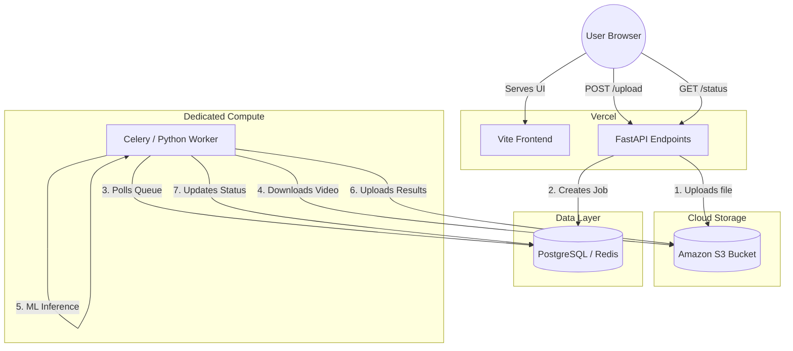

# Deployment Architecture Plan

## 1. Trace: Complete Video Processing Pipeline

1. **User Action:** User interacts with the UI (e.g., `ProcessingSessionManager.tsx`).
2. **API Call:** Frontend calls `POST /upload` with the video file.
3. **FastAPI Endpoint:** `@app.post("/upload")` in `backend/main.py` receives the file.
4. **Local Storage:** The file is saved directly to the local disk at `datasets/live/orig_{filename}` using `shutil.copyfileobj`.
5. **Job Creation:** `create_job()` initializes a `JobStatus` object inside the global, in-memory `_jobs` dictionary.
6. **Background Schedule:** FastAPI's `BackgroundTasks` queues `start_job`. The HTTP response returns immediately to the frontend.
7. **Processing Trigger:** `start_job` invokes `asyncio.create_task(_run_pipeline)`.
8. **Preprocessing:** `_run_pipeline` (in `job_manager.py`) uses `imageio_ffmpeg` and `subprocess` to scale the video via FFmpeg.
9. **AI Initialization:** `initialize_model()` (in `engine.py`) loads `YOLO('yolov8n.pt')`, downloading it if it doesn't exist locally.
10. **Inference Loop:** `process_video` reads the video frame-by-frame with OpenCV (`cv2.VideoCapture`). It runs `model.track()` on each frame.
11. **Annotation:** OpenCV draws bounding boxes and writes frames to a temporary annotated `.mp4` file.
12. **Postprocessing:** FFmpeg is called again to convert the annotated video to a web-compatible H.264 format.
13. **JSON Export:** Detections and tracking data are written to `outputs/detection/json/`.
14. **Synchronous Sub-phases:** The pipeline sequentially imports and executes `run_phase2`, `run_phase3`, and `run_phase4` to generate behavior, business, and recommendation reports (writing dozens of JSON/CSV/MD files to `outputs/`).
15. **Status Polling:** The frontend continuously polls `GET /status/{video_id}`.
16. **Job Completion:** The in-memory `JobStatus` is updated to `Completed`, and the frontend fetches results.

---

## 2. Worker Requirements

Based on codebase inspection:

*   **Python Version:** Python 3.8+ (Required by FastAPI, Ultralytics).
*   **CPU:** HIGH. FFmpeg runs twice per video. OpenCV and YOLO run synchronously per frame.
*   **RAM:** HIGH. Entire video frames and PyTorch models are loaded into memory.
*   **GPU:** OPTIONAL BUT HIGHLY RECOMMENDED.
*   **FFmpeg:** REQUIRED (`imageio-ffmpeg` package is utilized).
*   **OpenCV:** REQUIRED (`cv2` dependency).
*   **PyTorch:** REQUIRED (underlying framework for Ultralytics).
*   **ML Model/Framework:** Ultralytics YOLOv8.
*   **Model Size:** ~6.5MB (`yolov8n.pt` - Nano model).
*   **Model Loading Time:** < 2 seconds.
*   **Average Video Size:** UNKNOWN — REQUIRES MEASUREMENT
*   **Maximum Video Size:** UNKNOWN — REQUIRES MEASUREMENT
*   **Typical Processing Duration:** UNKNOWN — REQUIRES MEASUREMENT
*   **Maximum Processing Duration:** UNKNOWN — REQUIRES MEASUREMENT
*   **Concurrency Requirements:** 1 thread per video. Concurrent jobs require multi-threading/multi-processing orchestration.
*   **Temporary Disk:** REQUIRED. Uncompressed annotated frames are written to disk before FFmpeg conversion.
*   **Persistent Disk:** REQUIRED (currently). Application expects to read historical `outputs/` indefinitely.

---

## 3. Worker GPU Requirement

**Result:** CPU ONLY is supported, but CUDA/GPU is strongly recommended.

**Analysis of Inference Code (`backend/services/engine.py`):**
The code initializes the model via `model = YOLO('yolov8n.pt')` and runs inference via `model.track(...)`. It does not explicitly force `device="cpu"` or `device="cuda"`. 
*   **CPU Fallback:** By design, PyTorch and Ultralytics automatically detect the environment. If no CUDA-capable GPU is found, it silently falls back to CPU execution.
*   **Impact:** Because this is video processing (e.g., 30 frames per second), running YOLOv8n on a standard CPU can take 0.1s to 0.5s per frame. A 60-second video could take 10-30 minutes to process. A GPU reduces this to near real-time.

---

## 4. Queue Requirements

The current system uses an in-memory dictionary `_jobs: Dict[str, JobStatus]`.

*   **Job States:** Queued, Running, Completed, Cancelled, Failed.
*   **State Transitions:** Queued → Running → Completed/Failed. Cancelled → Queued (via Resume).
*   **Job ID:** UUID `session_id`.
*   **Retry Behavior:** None implemented natively (except manual resume).
*   **Failure Behavior:** Exception is caught, trace printed, state set to `Failed: {error}`.
*   **Cancellation:** Sets status to `Cancelled`, though running tasks don't actively halt in the middle of a frame loop.
*   **Concurrent Jobs:** Supported only by Uvicorn's async event loop.
*   **Polling Interval:** Frontend polls every 5 seconds.
*   **Survival Across Restarts:** NO.

**Minimum Persistent Job State Design:**
To replace `_jobs`, you need a central database table (e.g., Postgres `jobs` table) or a Redis hash containing:
`session_id` (PK), `filename`, `status`, `progress`, `current_stage`, `created_at`, `completed_at`, `error_message`.

---

## 5. Storage Requirements

| Directory | Type | Persistence Requirement | Access Pattern | Size |
| :--- | :--- | :--- | :--- | :--- |
| `datasets/` | Static Assets | Yes (Bundled/S3) | Read-only by worker/API | Medium |
| `datasets/live/` | User Uploads | Yes (S3) | Written by API, Read by worker | Large |
| `outputs/detection/videos/`| Generated Results | Yes (S3) | Written by worker, Downloaded by UI | Large |
| `outputs/behavior/` | Generated Data (JSON) | Yes (DB/S3) | Written by worker, Polled by UI | Small |
| `outputs/analytics/` | Generated Data (Img) | Yes (S3) | Written by worker, Polled by UI | Medium |
| `yolov8n.pt` | Model Files | Temporary/Bundled | Downloaded once on worker start | Small (6.5MB) |

---

## 6. Architecture Comparison

### A. Everything on Vercel
*   **Compatibility:** Incompatible.
*   **Reason:** Vercel functions are stateless and read-only. BackgroundTasks are instantly killed when the HTTP request ends. Videos cannot be saved to the filesystem.

### B. Vercel Frontend + Vercel API + External Worker
*   **Compatibility:** Excellent.
*   **Complexity:** Medium. Requires decoupling API from processing.
*   **Storage:** AWS S3 (API uploads to S3, Worker downloads).
*   **Queue:** Redis or Postgres.
*   **CPU/GPU:** Worker runs on EC2/Render (GPU optional).
*   **Scaling:** Web API auto-scales infinitely. Worker scales based on queue depth.

### C. Vercel Frontend + Render API + Render Worker
*   **Compatibility:** Good.
*   **Complexity:** Medium.
*   **Storage:** Render Disk or S3.
*   **Queue:** Redis (Render managed).
*   **Scaling:** Harder to auto-scale than Vercel, but avoids 10-second serverless timeouts if the API needs to do heavy lifting before queuing.

### D. Vercel Frontend + FastAPI/Worker on AWS (ECS/EC2)
*   **Compatibility:** Excellent.
*   **Complexity:** High (requires AWS networking, IAM, VPC knowledge).
*   **Deployment:** Complex CI/CD pipelines.

### E. Single Docker Deployment (API + Worker on 1 VM)
*   **Compatibility:** Excellent.
*   **Complexity:** Low.
*   **Storage:** Local disk mounts.
*   **Queue:** Built-in memory or lightweight SQLite/Redis container.
*   **Scaling:** None. Single point of failure.

---

## 7. Recommended Target Architecture

**Architecture B** is the most robust target. It leverages Vercel for the web assets and lightweight routing, while isolating the heavy, stateful ML tasks to a dedicated worker.

---

## 8. Migration Plan

### PHASE 1: Frontend/API Vercel Deployment
*   **Goal:** Get the static UI and read-only endpoints online.
*   **Files to change:** `vercel.json`, `frontend/src/api/config.ts`, `backend/main.py`.
*   **Tests:** Ensure frontend loads and basic API health checks pass.

### PHASE 2: Persistent Storage Integration
*   **Goal:** Replace `os.makedirs` and local `open(file, 'wb')`.
*   **Files to change:** `main.py` (`/upload` endpoint), `engine.py` (saving annotated videos), `job_manager.py` (FFmpeg inputs/outputs).
*   **Configuration:** Add `boto3` for AWS S3.
*   **Tests:** Upload a video and verify it lands in the S3 bucket.

### PHASE 3: Job Queue Integration
*   **Goal:** Replace the `_jobs` dictionary.
*   **Files to change:** `job_manager.py`.
*   **Configuration:** Add `psycopg2` or `redis` library.
*   **Tests:** Submit a job and verify the database record is created.

### PHASE 4: Worker Deployment
*   **Goal:** Detach `BackgroundTasks` into a separate process.
*   **Files to change:** `main.py` (remove `BackgroundTasks`), `worker.py` (create new entrypoint).
*   **Configuration:** Add `celery` or `rq`. Deploy a worker instance (e.g., to Render or AWS EC2).
*   **Tests:** Worker picks up job from Phase 3, downloads from Phase 2, processes, and uploads results.

### PHASE 5: Database Migration (JSON Data)
*   **Goal:** Stop saving JSON/CSV to disk (`outputs/business/`).
*   **Files to change:** All analytics scripts in `backend/services/`.
*   **Tests:** UI dashboards load data from API SQL queries rather than fetching flat JSON files.

### PHASE 6: Production Testing
*   **Tests:** End-to-end video upload, queue polling, and analytics rendering on the live domain.

---

## 9. Required Environment Variables

When fully migrated, the following environment variables will be required:

*   `DATABASE_URL` (For Postgres job/analytics state)
*   `REDIS_URL` (For Celery/RQ message broker)
*   `AWS_ACCESS_KEY_ID` (For S3)
*   `AWS_SECRET_ACCESS_KEY` (For S3)
*   `AWS_REGION` (For S3)
*   `AWS_BUCKET_NAME` (For S3)
*   `API_BASE_URL` (For Frontend)
*   `WORKER_CONCURRENCY` (Optional, to limit threads on the worker)
