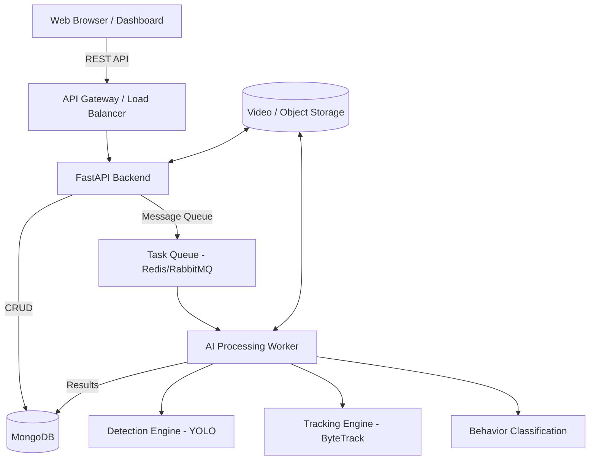
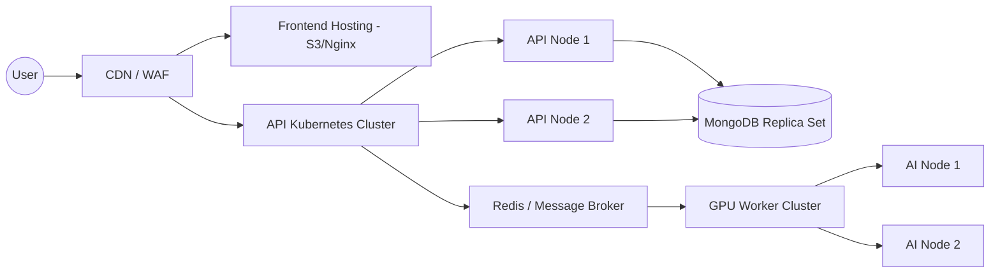
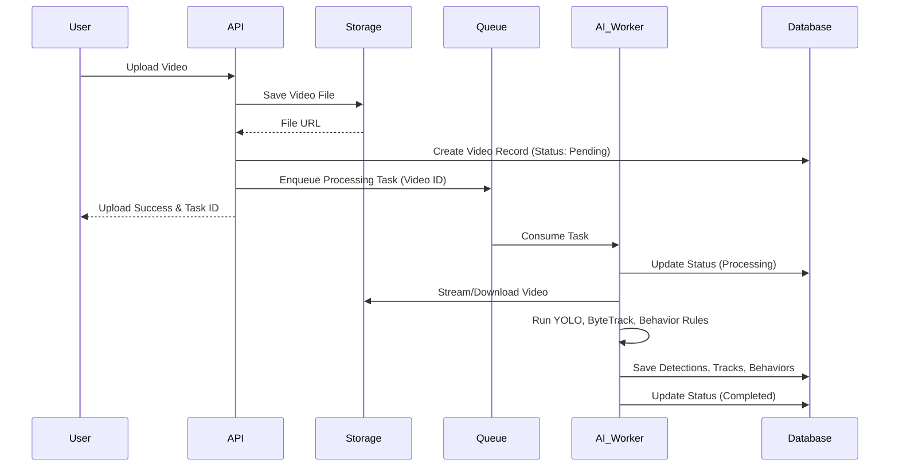

# Software Architecture Document (SAD)
## RetailVision AI

---

## 1. Executive Summary
RetailVision AI is an advanced video analytics platform designed to decode customer behavior in retail environments. By leveraging state-of-the-art computer vision models, it tracks customer movements, analyzes interactions with shelves, and categorizes specific behaviors (e.g., picking, putting back, turning to shelf). This architecture document outlines the technical foundation, components, and design principles required to deliver a robust, scalable, and secure enterprise application.

## 2. Problem Statement
Retailers lack granular visibility into customer behavior within physical stores. Traditional security cameras capture footage but do not translate it into actionable intelligence. Key interactions—such as which products are picked up but not purchased, or how customers navigate aisles—remain invisible, leading to missed opportunities for layout optimization, inventory management, and targeted marketing.

## 3. Product Vision
To empower retailers with real-time, actionable insights by transforming raw store footage into structured behavioral data through scalable, privacy-conscious AI analytics.

---

## 4. Functional Requirements
- **Video Ingestion:** Upload and process pre-recorded video feeds.
- **Person Detection & Tracking:** Identify and continuously track individuals across the store.
- **Zone Intelligence:** Define and monitor Regions of Interest (ROIs) representing shelves, aisles, and checkout areas.
- **Behavior Recognition:** Classify customer interactions (Touching, Turning to Shelf, Picking and Returning, Picking and Putting).
- **Analytics Dashboard:** Visualize KPIs, behavioral trends, and customer flow.
- **AI Business Advisor:** Provide automated, actionable recommendations based on analytics.

## 5. Non-Functional Requirements
- **Performance:** Support concurrent processing of multiple video streams with target processing times.
- **Scalability:** Ability to scale AI processing nodes horizontally based on demand.
- **Security:** End-to-end encryption for stored videos, secure REST APIs, and role-based access control (RBAC).
- **Maintainability:** Modular architecture allowing independent upgrades of the Detection, Tracking, and Classification models.
- **Reliability:** 99.9% uptime for the web platform and robust error handling in the video processing pipeline.

---

## 6. Overall System Architecture

---

## 7. Layered Architecture

The system follows a strict n-tier enterprise architecture.

1. **Presentation Layer (React):** Handles the user interface, dashboard rendering, and user interactions.
2. **Application Layer (FastAPI):** Exposes RESTful APIs, handles routing, input validation, and request orchestration.
3. **Business Layer:** Encapsulates core business logic, including analytics aggregation, rules engines, and reporting logic.
4. **AI Processing Layer:** A suite of decoupled microservices or background workers running inference (Detection, Tracking, Behavior Analysis).
5. **Infrastructure Layer:** Manages message queues, caching (Redis), and orchestration (Docker/Kubernetes).
6. **Storage Layer (MongoDB & Object Storage):** Stores metadata, application state, and large blob objects (videos).

---

## 8. Component Architecture

- **Web Frontend:** Single Page Application (SPA) providing visual analytics.
- **Core API Service:** Handles user management, video metadata, and serves analytics data.
- **Ingestion Service:** Specialized service for handling large video file uploads and transcoding.
- **Inference Pipeline:** Sequentially processes video frames through YOLO, ByteTrack, and behavior classifiers.
- **Analytics Aggregator:** A background chron job/service that rolls up granular frame-level data into hourly/daily statistics.

---

## 9. Deployment Architecture

---

## 10. Sequence Flow: Video Processing

---

## 11. Data Flow

1. **Raw Data:** Uploaded videos are securely stored in blob storage.
2. **Interim Data:** Video frames are passed through memory to AI models; bounding boxes and track IDs are generated.
3. **Structured Data:** Metadata (Tracks, Zones, Behaviors) are persisted into MongoDB documents.
4. **Aggregated Data:** Rollup jobs process structured data to produce timeline metrics (e.g., hourly interactions per shelf).
5. **Presentation Data:** APIs serve JSON formatted aggregated data for UI charting components.

---

## 12. Technology Stack

| Layer | Technology | Justification |
|---|---|---|
| **Frontend** | React, TypeScript, Tailwind | Component-based, strongly typed, enterprise UI standard. |
| **Backend API** | FastAPI (Python) | High performance, async support, ideal for ML integrations. |
| **Database** | MongoDB | Document structure fits hierarchical video and tracking data perfectly. |
| **AI - Detection** | YOLO | State-of-the-art balance of speed and accuracy for person detection. |
| **AI - Tracking** | ByteTrack | Robust multi-object tracking, handles occlusions well. |
| **Storage** | S3 / MinIO (Local) | Reliable object storage for large video files. |
| **Task Queue** | Celery + Redis | Standard, robust background task management for Python. |
| **Deployment** | Docker & Docker Compose | Ensures environment parity from dev to production. |

---

## 13. AI Pipeline Overview
The AI pipeline operates sequentially to ensure data dependencies are met:
1. **Frame Extraction:** Extract frames at the designated FPS.
2. **Spatial Detection:** YOLO detects persons in the frame.
3. **Temporal Tracking:** ByteTrack assigns unique IDs to persons across sequential frames.
4. **Zone Mapping:** Intersects track coordinates with predefined ROI polygons.
5. **Action Classification:** Analyzes track history and spatial relationships to classify behaviors (e.g., if a track overlaps a shelf zone for X seconds and hand bounding boxes intersect product boundaries).

---

## 14. Security Considerations
- **Data Privacy:** Faces can be optionally blurred in processed output videos to comply with privacy regulations (GDPR/CCPA).
- **API Security:** All endpoints secured via JWT authentication. Rate limiting implemented on the API Gateway.
- **Database Security:** MongoDB deployed with authentication enabled, network isolation, and at-rest encryption.

---

## 15. Scalability Strategy
- **Stateless APIs:** FastAPI backend nodes are entirely stateless and can be scaled horizontally behind a load balancer.
- **Decoupled Workers:** AI processing is decoupled via message queues. GPU worker nodes can be scaled independently of the web APIs based on the processing queue length.
- **Database Sharding:** MongoDB can be horizontally sharded by `project_id` or `video_id` as data volume grows.

---

## 16. Maintainability Strategy
- **Containerization:** All services dockerized to avoid "works on my machine" issues.
- **Modular AI:** AI models wrapped in standard interfaces. Upgrading YOLO to a newer version requires only updating the Detection Engine module.
- **Comprehensive Logging:** Centralized logging for both API requests and AI inference steps.

---

## 17. Future Expansion Strategy
- **Multi-Camera Stitching:** Future architectural support for ReID (Re-Identification) models to track customers across multiple overlapping or non-overlapping camera feeds.
- **Edge Deployment:** Architecture supports packaging the AI Worker for edge deployment (running on in-store hardware) while the API and DB remain in the cloud.
- **Advanced Insights:** Future integration of LLMs to automatically generate plain-text business advice based on the aggregated analytics data.
